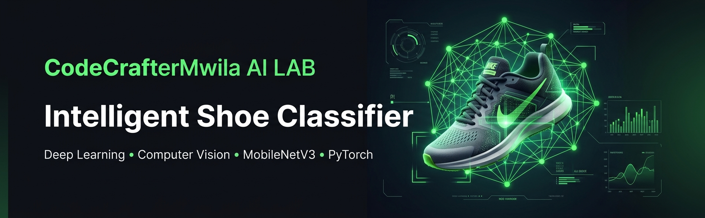

# 👟 AI-Powered Shoe Classification Web App

> A production-grade computer vision web application built with **PyTorch**, **MobileNetV3 (Small)**, and **Streamlit**. Designed with a GitHub-inspired dark aesthetic and neon green accents, featuring live camera inference, batch processing, MLOps confidence thresholds, and automated reporting.

---

## ✨ Features & Architecture

- **🧠 Deep Learning Backbone**: Fine-tuned **MobileNetV3 Small** convolutional neural network optimized for fast, lightweight edge and web inference.
- **⚡ Multi-Mode Input Selection**:
  * **Custom Uploads**: Supports single or multi-image drag-and-drop processing (`JPG`, `JPEG`, `PNG`).
  * **Instant Sample Gallery**: Pre-loaded test samples for instant one-click testing without local files.
  * **Live Camera Capture**: Real-time webcam or mobile camera integration via `st.camera_input()`.
- **📊 Batch Processing & MLOps Controls**:
  * Bulk inference capability across multiple images with a summary results dataframe.
  * Dynamic sidebar confidence threshold slider for uncertainty flagging and out-of-distribution handling.
- **⏱️ Performance Benchmarking & Reporting**: Real-time inference latency tracking in milliseconds (`ms`) and automated CSV report generation for single or batch runs.

---

## 🛠️ Tech Stack

- **Language**: Python 3.10+
- **Deep Learning Framework**: PyTorch & Torchvision
- **Frontend & UI**: Streamlit (Custom Dark Theme `#0E1117` with Neon Accents `#00FF66`)
- **Data Processing**: Pandas & NumPy
- **Image Processing**: Pillow (PIL)

---

## 🚀 Quickstart & Installation

Clone the repository and run the application using your preferred cross-platform setup method:

### Method 1: Using the Cross-Platform Python Launcher (Recommended)
Works seamlessly across Windows, macOS, and Linux to automate environment setup and app launch:
**python run.py**

### Method 2: Using Makefile (Linux / macOS / Git Bash)
Automates virtual environment creation and package installation via terminal targets:
**make setup**
**make run**

### Method 3: Manual Setup
Configure your environment manually using standard terminal commands: 

**1. Create and activate virtual environment**
python -m venv venv
source venv/bin/activate  # On Windows use: venv\Scripts\activate

**2. Install dependencies**
pip install --upgrade pip
pip install -r requirements.txt

**3. Launch the Streamlit application**
streamlit run app.py

# 👨‍💻 Developer
## Mwila Singoma (AKA CodeCrafterMwila)

### Bachelor of Data Science Student | Mulungushi University 🇿🇲 Zambia

**Specialisations**: Artificial Intelligence, Deep Learning, Computer Vision, Machine Learning, Python Development.

© 2026 CodeCrafterMwila AI Lab.