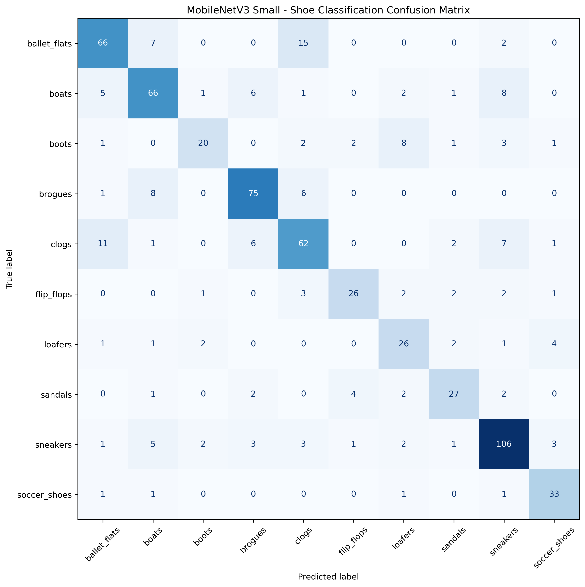

# 👟 AI-Powered Shoe Classification


A deep-learning-based shoe classification web application built using **PyTorch, MobileNetV3 Small and Streamlit**. The application identifies shoe categories from uploaded images, sample images and camera captures, with support for batch predictions and downloadable reports.

The project demonstrates image classification, transfer learning, model fine-tuning, performance evaluation and deployment through an interactive web interface.

---

## 📌 Table of Contents

1. [Project Overview](#-project-overview)
2. [Features](#-features)
3. [Technology Stack](#-technology-stack)
4. [Model Architecture](#-model-architecture)
5. [Dataset](#-dataset)
6. [Data Preprocessing](#-data-preprocessing)
7. [Training Methodology](#-training-methodology)
8. [Model Evaluation](#-model-evaluation)
9. [Installation and Setup](#-installation-and-setup)
10. [Running the Application](#-running-the-application)
11. [Project Structure](#-project-structure)
12. [Limitations and Future Improvements](#-limitations-and-future-improvements)
13. [Developer](#-developer)

---

## 🔍 Project Overview

This project uses a convolutional neural network (CNN) to classify shoe images into ten different categories.

The classification model is based on **MobileNetV3 Small**, a lightweight neural network architecture that uses pretrained ImageNet weights.

Transfer learning is applied by replacing the original classification layer with a new layer designed for the ten shoe categories. The model is subsequently fine-tuned to improve its ability to recognise footwear features.

A Streamlit application provides an interactive interface for testing the trained model.

### Supported Shoe Categories

The model recognises the following ten categories:

1. Ballet Flats
2. Boats
3. Boots
4. Brogues
5. Clogs
6. Flip-Flops
7. Loafers
8. Sandals
9. Sneakers
10. Soccer Shoes

---

## ✨ Features

### Image Classification
- Upload individual shoe images.
- Supports JPG, JPEG and PNG images.
- Displays the predicted shoe category.
- Displays the model's prediction confidence.

### Sample Image Gallery
- Includes three sample images.
- Allows users to test the model without uploading their own images.

### Camera Capture
- Supports taking photographs using a webcam or compatible mobile camera.
- Captured photographs can be submitted for classification.

### Batch Image Classification
- Supports processing multiple uploaded images.
- Displays predictions in a results table.
- Provides a downloadable CSV report.

### Confidence Threshold
- Includes an adjustable confidence threshold.
- Flags predictions whose confidence scores fall below the selected threshold.
- Helps users identify predictions that may require additional inspection.

**Note:** A confidence threshold does not guarantee correct classification or provide verified out-of-distribution detection.

### Performance Monitoring
- Measures inference time in milliseconds.
- Displays classification results and confidence scores.
- Supports performance inspection during application use.

---

## 🛠️ Technology Stack

| Technology | Purpose |
|---|---|
| Python | Main programming language |
| PyTorch | Deep-learning framework |
| Torchvision | Model architecture and image transformations |
| MobileNetV3 Small | Image classification architecture |
| Streamlit | Interactive web application |
| NumPy | Numerical operations |
| Pandas | Data handling and CSV reporting |
| Pillow | Image processing |
| Scikit-learn | Dataset splitting and model evaluation |
| Matplotlib | Visualisation |
| Seaborn | Confusion matrix visualisation |

---

## 🧠 Model Architecture

The classification model uses **MobileNetV3 Small** with pretrained ImageNet weights.

MobileNetV3 Small is designed to provide efficient image recognition while maintaining a relatively lightweight architecture.

### Transfer Learning

The model development process consists of two main stages.

**Stage 1: Transfer Learning**

- Load pretrained MobileNetV3 Small weights.
- Freeze the feature extraction layers.
- Replace the original classification layer.
- Configure the new classifier for ten shoe categories.
- Train the new classification layer.

**Stage 2: Fine-Tuning**

- Unfreeze the final three feature blocks.
- Keep the earlier feature extraction blocks frozen.
- Apply lower learning rates to the pretrained feature blocks.
- Continue training to improve feature adaptation to the shoe dataset.

### Model Configuration

| Parameter | Configuration |
|---|---|
| Architecture | MobileNetV3 Small |
| Pretrained weights | ImageNet |
| Input dimensions | 224 × 224 |
| Number of classes | 10 |
| Loss function | CrossEntropyLoss |
| Initial optimizer | Adam |
| Initial learning rate | 0.001 |
| Fine-tuning optimizer | Adam |
| Fine-tuning epochs | 8 |
| Weight decay | 0.0001 |
| Gradient clipping | Maximum norm 1.0 |

The best-performing model checkpoint is saved and subsequently loaded by the Streamlit application.

---

## 📂 Dataset

The project uses the **Shoe Dataset** published by `shravya11` on Hugging Face.

Dataset repository:

`shravya11/shoe-dataset`

The dataset is available on the Hugging Face Datasets platform.

### Dataset Attribution

Original dataset creator: **shravya11**

Licence: **Creative Commons Attribution 4.0 International (CC BY 4.0)**, as indicated by the original dataset card.

The original dataset contains multiple components, including shoe classification images and a separate COCO-format shoe dataset.

### Local Classification Dataset

The local classification dataset used for model development contains:

**4,493 images across 10 shoe categories.**

| Category | Images |
|---|---:|
| ballet_flats | 600 |
| boats | 600 |
| boots | 249 |
| brogues | 600 |
| clogs | 600 |
| flip_flops | 249 |
| loafers | 249 |
| sandals | 249 |
| sneakers | 849 |
| soccer_shoes | 248 |
| **Total** | **4,493** |

The original Hugging Face dataset card documents 4,494 training images. The local copy used in this project contains 4,493 images, a difference of one image.

### Dataset Preparation

The notebook expects the classification images to be organised into class-specific folders:

```text
dataset/
└── shoe-dataset/
    ├── train/
    │   ├── ballet_flats/
    │   ├── boats/
    │   ├── boots/
    │   ├── brogues/
    │   ├── clogs/
    │   ├── flip_flops/
    │   ├── loafers/
    │   ├── sandals/
    │   ├── sneakers/
    │   └── soccer_shoes/
```

Download the original dataset from Hugging Face and arrange the classification images into the expected directory structure.

**Important:** The `dataset/` directory is excluded from GitHub. Anyone wishing to reproduce model training must obtain and prepare the dataset separately.

The original validation directory is not used in the final notebook's train-validation-test split. Instead, the notebook creates new subsets from the local training directory.

---

## 🖼️ Data Preprocessing

All images are resized to:

**224 × 224 pixels**

The training pipeline applies data augmentation to improve the model's ability to generalise to different image appearances.

### Training Transformations

- Resize to 224 × 224.
- Random horizontal flipping.
- Random rotation of up to 10 degrees.
- Random brightness adjustment.
- Random contrast adjustment.
- Random saturation adjustment.
- Conversion to tensors.
- ImageNet normalisation.

### Validation and Testing Transformations

- Resize to 224 × 224.
- Conversion to tensors.
- ImageNet normalisation.

Random augmentation is applied only during training, while validation and testing use deterministic image transformations.

### Dataset Splitting

The notebook uses stratified random sampling to divide the 4,493 local images.

| Dataset subset | Images | Percentage |
|---|---:|---:|
| Training | 3,145 | 70% |
| Validation | 674 | 15% |
| Testing | 674 | 15% |
| **Total** | **4,493** | **100%** |

Stratification helps preserve the class distribution across the three subsets.

---

## ⚙️ Training Methodology

The model is trained using a two-stage transfer learning approach.

### Stage 1: Initial Training

- Freeze the MobileNetV3 feature extraction layers.
- Train the replacement classification layer.
- Use Adam optimisation.
- Apply a learning rate of 0.001.
- Use CrossEntropyLoss.
- Train for 10 epochs.
- Monitor validation accuracy.
- Save the best-performing validation checkpoint.

### Stage 2: Fine-Tuning

- Unfreeze the final three feature blocks.
- Keep earlier feature blocks frozen.
- Use separate learning rates for the feature extractor and classifier.
- Apply gradient clipping.
- Monitor validation loss.
- Save the best-performing fine-tuned checkpoint.

Fine-tuning configuration:

| Parameter | Value |
|---|---:|
| Fine-tuning epochs | 8 |
| Feature extractor learning rate | 0.00001 |
| Classifier learning rate | 0.0001 |
| Weight decay | 0.0001 |
| Gradient clipping | 1.0 |
| Early stopping patience | 3 |

All eight fine-tuning epochs were completed.

The best fine-tuning validation accuracy was **74.33%**, achieved at epoch 7.

---

## 📊 Model Evaluation

The trained model was evaluated using a separate test subset containing 674 images.

### Overall Performance

| Metric | Result |
|---|---:|
| Test images | 674 |
| Correct predictions | 507 |
| Incorrect predictions | 167 |
| Test accuracy | **75.22%** |
| Macro precision | 0.75 |
| Macro recall | 0.74 |
| Macro F1-score | 0.74 |
| Weighted F1-score | 0.75 |

### Classification Report

| Shoe Category | Precision | Recall | F1-score | Support |
|---|---:|---:|---:|---:|
| Ballet Flats | 0.76 | 0.73 | 0.75 | 90 |
| Boats | 0.73 | 0.73 | 0.73 | 90 |
| Boots | 0.77 | 0.53 | 0.62 | 38 |
| Brogues | 0.82 | 0.83 | 0.82 | 90 |
| Clogs | 0.67 | 0.69 | 0.68 | 90 |
| Flip-Flops | 0.79 | 0.70 | 0.74 | 37 |
| Loafers | 0.60 | 0.70 | 0.65 | 37 |
| Sandals | 0.75 | 0.71 | 0.73 | 38 |
| Sneakers | 0.80 | 0.83 | 0.82 | 127 |
| Soccer Shoes | 0.77 | 0.89 | 0.82 | 37 |

### Evaluation Visualisations

The project generates and stores the following evaluation outputs:

**Classification Report**

`results/classification_report.txt`

**Confusion Matrix**



### Performance Interpretation

The model achieved an overall test accuracy of **75.22%**.

Some observations:

- Soccer shoes achieved the highest recall at 0.89.
- Brogues and sneakers achieved F1-scores of 0.82.
- Boots had the lowest recall at 0.53.
- Loafers had the lowest precision at 0.60.

These results indicate that the model can recognise several shoe categories reasonably well, although classification performance varies between categories.

---

## 🚀 Installation and Setup

### Prerequisites

Before installing the project, ensure you have:

- Python 3.12 recommended.
- Git.
- An internet connection for dependency installation.
- A compatible operating system.
- Sufficient memory and storage.

A CUDA-compatible NVIDIA GPU is optional. The application can also run using CPU inference.

### 1. Clone the Repository

```bash
git clone https://github.com/CodeCrafterMwila/ICD311_Shoe_Classifier.git
```

Navigate into the project:

```bash
cd ICD311_Shoe_Classifier
```

### 2. Create a Virtual Environment

```bash
python -m venv venv
```

Activate it on Windows:

```cmd
venv\Scripts\activate
```

On Linux or macOS:

```bash
source venv/bin/activate
```

### 3. Install Application Dependencies

Upgrade pip:

```bash
python -m pip install --upgrade pip
```

Install the required packages:

```bash
pip install -r requirements.txt
```

The requirements file contains the pinned application dependencies:

```text
streamlit==1.37.1
torch==2.14.1
torchvision==0.29.1
pandas==2.2.2
Pillow==10.4.0
```

**GPU note:** CUDA support depends on the installed PyTorch wheel, CUDA runtime compatibility and available hardware. The standard requirements file does not guarantee a CUDA-enabled installation. Follow the official PyTorch installation instructions when configuring GPU support.

### 4. Launch the Application

```bash
streamlit run app.py
```

Alternatively, use the included launcher:

```bash
python run.py
```

The launcher creates a virtual environment if one does not exist, installs the requirements and starts the Streamlit application.

---

## 🧪 Reproducing Model Training

The project includes the original development notebook:

`shoe_classifier.ipynb`

To reproduce training and evaluation, additional scientific computing dependencies are required.

Install them using:

```bash
pip install numpy matplotlib scikit-learn seaborn
```

Ensure the dataset has been downloaded and prepared in the expected directory structure.

Open the notebook using Jupyter:

```bash
jupyter notebook shoe_classifier.ipynb
```

Alternatively, open the notebook in Visual Studio Code with a compatible Python kernel.

The notebook contains the dataset loading, preprocessing, training, fine-tuning and evaluation workflow.

---

## 📁 Project Structure

```text
ICD311_Shoe_Classifier/
│
├── .streamlit/
│   └── config.toml
│
├── assets/
│   ├── banner.png
│   └── samples/
│       ├── my_shoe10.jpg
│       ├── my_shoe11.jpg
│       └── shoe3.jpg
│
├── dataset/
│   └── shoe-dataset/
│       ├── train/
│       └── validation/
│
├── models/
│   └── shoe_classifier_mobilenetv3.pth
│
├── results/
│   ├── classification_report.txt
│   └── confusion_matrix.png
│
├── app.py
├── Launch_Shoe_Classifier.bat
├── Makefile
├── README.md
├── requirements.txt
├── run.py
└── shoe_classifier.ipynb
```

The dataset directory is excluded from version control.

The trained model checkpoint, application, notebook, sample images and evaluation outputs are included in the GitHub repository.

---

## ⚠️ Limitations and Future Improvements

Although the model achieves 75.22% test accuracy, there are several areas where further development could improve its performance.

### Current Limitations

- Classification accuracy varies across shoe categories.
- Some categories have fewer training examples than others.
- Boots have comparatively low recall.
- Visually similar shoe categories can be difficult to distinguish.
- Predictions depend on image quality, lighting, orientation and background.
- Confidence scores do not guarantee prediction correctness.
- The application is designed for image classification rather than object detection.

### Future Improvements

Potential improvements include:

1. Expanding the dataset with more diverse shoe images.
2. Improving class balance.
3. Experimenting with alternative CNN architectures.
4. Applying additional data augmentation strategies.
5. Hyperparameter optimisation.
6. Improving performance on visually similar categories.
7. Evaluating the model on completely independent real-world images.
8. Exploring model quantisation and deployment optimisation.

---

## 👨‍💻 Developer

**Mwila Singoma**

Also known as **CodeCrafterMwila**

Bachelor of Data Science Student
Mulungushi University 🇿🇲 Zambia

### Areas of Interest

- Artificial Intelligence
- Machine Learning
- Deep Learning
- Computer Vision
- Python Development
- Data Science

### GitHub

### GitHub

[CodeCrafterMwila](https://github.com/CodeCrafterMwila)

---

## 📜 Acknowledgements

- Original shoe dataset: [shravya11/shoe-dataset](https://huggingface.co/datasets/shravya11/shoe-dataset)
- PyTorch and Torchvision for deep-learning tools.
- Streamlit for the interactive application framework.
- Scikit-learn for model evaluation.
- The open-source Python community.

---

© 2026 CodeCrafterMwila AI Lab.
